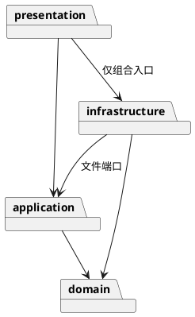

# Lab1 Phase 1：架构与开发记录

## 架构方案（初版）

- `src/domain`：图形类层次、Composite 容器、画布、唯一 id 与树结构约束，不依赖其他层。
- `src/application`：Command 对象、撤销重做、编辑事务、文件端口，不依赖具体 IO。
- `src/infrastructure`：SVG XML 编解码与本地文件端口实现，依赖领域层与应用端口。
- `src/presentation`：命令分词、命令注册与 REPL，在入口注入文件端口。
- `tests`、`examples`：行为验证和可回放会话。

Command 必须落地为命令对象；编辑在文档副本上执行，成功后替换当前文档并记录前后快照。Composite 统一叶子与容器操作。图形工厂和命令注册表是仅有的两处按名称选择实现的边界，后续插件阶段需把内置注册抽离。

## 过程记录

1. 根据需求确认仅实现 rect/circle/ellipse/line/text/g 六种类型，box 留到插件化阶段。
2. 开始实现前确定分层与依赖方向；先提交方案和工程配置，再分步提交领域层、命令层、测试及文档。
3. 文档未规定跨父级 group 的新组位置，本实现选根级新建，成员按原文档深度优先顺序收编；该决定将在最终说明中保留。

## 一致性自查

待完成实现后据实际代码更新。

## 质量保证手段

计划运行严格 TypeScript 检查、完整构建、Node 行为测试以及典型会话脚本；最终结果按实际记录。
