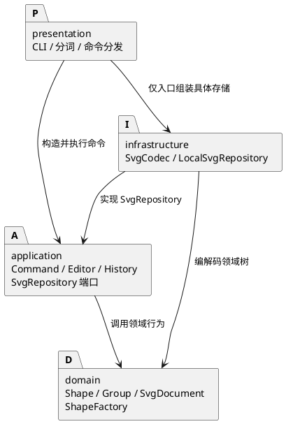

# Lab1 Phase 1：架构与开发记录

本工程实现 TypeScript 面向对象 SVG 命令行编辑器，范围为 rect、circle、ellipse、line、text、g 六种内置元素。box 和插件加载属于后续阶段。本文件记录最终方案及实际迭代，不把 AI 自查写成人类审阅。

## 架构方案

### 模块划分与职责

| 模块 | 职责 | 主要实现 |
| --- | --- | --- |
| `src/domain/` | 封装图形状态、几何变换、父子关系、唯一 id、画布及树约束 | Shape、六种具体图形、ShapeFactory、SvgDocument |
| `src/application/` | 执行用例、编辑事务、历史、树展示及存储端口 | Editor、Command、EditCommand、History、TreeFormatter、SvgRepository |
| `src/application/commands/` | 每条命令的参数约束、编辑意图及结果反馈 | CreateCommand、MoveCommand 等，一类一文件 |
| `src/infrastructure/` | SVG XML 与领域对象转换；本地文件读写 | SvgCodec、LocalSvgRepository |
| `src/presentation/` | 分词、命令分发、交互及脚本运行；入口组装依赖 | CommandParser、CLI 入口等 |
| `tests/` | 领域、应用、SVG 与 CLI 的行为验证 | Node 测试运行器与断言 |
| `examples/` | 可回放命令与外部 SVG 输入 | flowchart.commands、other.svg |

### 设计模式如何落地

| 模式 | 实现 | 作用与代价 |
| --- | --- | --- |
| Command（要求项） | 抽象 Command.execute(editor)；每条命令有独立类；编辑命令继承 EditCommand 并实现 apply(document) | CLI 构造和调用命令；一次编辑对应一个历史单元，group 不拆成多次撤销 |
| Composite | Shape 统一 move、scale、setAttribute、clone、summary；Group 持有 Shape 子节点，维护父指针并防环 | 命令无需逐个判断图形类型；叶子与组共用编辑入口，组变换遍历子树 |
| Factory | ShapeFactory 内置类型名映射，支持 CLI 参数创建与 SVG 属性恢复 | 类型分派集中；未知类型统一报错；尚未开放插件注册 API |
| Memento | EditCommand 私有保存编辑前后文档的深拷贝；undo/redo 返回新副本；History 保存命令对象 | 完整恢复分组、删除和层级；复制成本随文档大小增长，历史内存随历史长度增长 |
| 端口与适配器 | 应用层定义 SvgRepository，LocalSvgRepository 实现，入口注入 Editor | 应用层无需访问文件系统，测试可用内存存储；未为不存在的远端需求增加抽象层 |

Editor.executeEdit 先克隆当前文档，在副本执行 apply；成功才捕获快照、替换当前文档并记录历史。解析、参数校验或编辑失败不会提交副本，也不会清空 redo。领域树修改预先验证约束；move/scale 先计算整棵子树的新数值，防止溢出产生部分更新。EditCommand 同一实例只允许捕获一次执行结果，避免复用实例覆盖历史中的旧快照；redo 使用已保存的结果。

History 维护 undo/redo 两栈。成功的新编辑清空 redo；init、read、save、带参数的 canvas 成功后调用 IO 屏障，清空历史并禁止撤销重做，直到下一次编辑。只读 canvas、tree、show、help 不进入历史，也不触发屏障。读写文件失败不会触发屏障。

### 依赖方向规则

1. domain 只依赖领域内部及语言标准能力，不依赖应用、展示、XML 库或文件系统。
2. application（含 commands）可以依赖 domain 和应用层内部类，不得导入 infrastructure、presentation 或具体文件系统实现。SvgRepository 是应用层端口。
3. infrastructure 可以依赖 domain、应用层 SvgRepository 端口、Node 文件工具和 XML 库，不得依赖展示层或操纵历史。
4. presentation 的解析器与运行器依赖应用层；组合入口额外依赖基础设施，构造 LocalSvgRepository 并注入 Editor。其他层不得反向依赖展示层。
5. tests 可导入各被测模块并使用 Node 测试与文件工具，不是运行时依赖；examples 与文档不参与代码依赖。

**两处名称分派及待重构项：**命令名映射只在 CommandParser；图形类型名映射只在 ShapeFactory。其余操作通过命令对象及图形多态完成，编解码器也调用同一工厂。插件阶段应把两处内置映射改成受约束的注册入口；本阶段保留集中映射，不预建插件发现、版本协商或动态加载框架。

### 变化点假设

| 可能变化 | 预留或选择 | 原因与边界 |
| --- | --- | --- |
| 新增图形、box 等复合图形 | Shape 行为与 Group 组合结构；构造集中在 ShapeFactory | 当前仅六种类型；未实现 ShapeProvider 或加载器，不声称插件接入零改动 |
| 新命令或其他交互界面 | Command 对象独立于输入输出；CLI 只构造命令 | 后续界面可复用 Editor；暂不引入 GUI 或 agent 协议 |
| 更换存储介质 | SvgRepository 接口和构造注入 | 只实现本地适配器，不预建凭证、缓存和远端冲突协议 |
| 扩展 SVG/CSS | 编解码集中在 SvgCodec；导入附加属性保留 | 未支持的元素明确拒绝，避免静默丢失；保留属性不等于解释全部语义 |
| 大文档与长历史性能 | 采用整文档快照，领域状态封装在对象内 | 本阶段优先撤销可靠性；未引入结构共享、差量补丁、历史容量限制或持久化撤销日志 |
| 世界坐标与变换矩阵 | 保留导入 transform，几何仍操作局部坐标 | 未实现矩阵求逆、坐标归一或跨父级世界位置保持 |

### 数据与 SVG 语义决策

- 图形及组 id 大小写敏感、全局唯一；导入根 SVG 自带的 id 也纳入防重。读入先预留全部显式 id，再按标签和序号为缺 id 节点命名并警告，避免自动名抢占后面的显式 id。
- create 的 in 只接受现有 g。根画布由 SvgDocument 表达，不是 Shape；根节点的 parent 为 null。
- 跨父级 group 在画布根末尾新建组，按原文档 DFS 顺序收编，不按参数顺序。重复参数、祖先与子孙同时入选、循环归属在修改前拒绝。
- ungroup 只解散嵌套组，子节点按序提升到父组中原组位置；按任务约定拒绝根级组。addto 放到目标组末尾；front/back 仅调整同级顺序。
- 画布宽高、缩放因子须有限且严格为正；坐标允许负数，几何尺寸、半径和 stroke-width 允许零、拒绝负数。数值使用十进制或科学计数，拒绝 NaN、Infinity 和十六进制等语法。省略 fill/stroke 时不生成属性，遵循 SVG 默认。
- set 只允许公共样式、各类型自身几何和 text 内容。导入的 transform、font-size、text-anchor 等可往返保留，但不会扩大修改白名单。g 上样式依照 SVG 继承生效，不批量改写子属性。
- move 给子树局部位置加增量，scale 同乘位置与几何尺寸；text 只缩放 x/y，字体大小等样式不变。已有 transform 原样保留。group/addto/ungroup 重挂时保留局部属性，**不会重算世界坐标或补偿继承样式**，因此有 transform 或父级样式的节点重挂后可能改变外观。
- 输入要求 SVG XML 命名空间，支持使用该命名空间的前缀。根 viewBox 和其他根属性保留；缺省尺寸取 viewBox 或 800×600。根尺寸支持无单位或 px，不支持百分比等单位。canvas 只改宽高，不重写已导入 viewBox。
- XML 库处理文本与属性转义；畸形 XML、重复 id、DOCTYPE、错误命名空间、未知元素、叶子中的子元素等读入失败。注释和原排版不属于领域内容，保存不保证字节级相同；往返目标是受支持树结构和属性语义。
- LocalSvgRepository 在同目录写唯一临时文件，完成后 rename 替换目标，失败清理临时文件，避免已有文件半写；未提供断电持久化保证。

本实现是受限 SVG 编辑内核，不是完整的通用 SVG/CSS 编辑器。

## 过程记录

记录来自实际实现、工具输出和 AI 工程自查。用户要求按任务文档本地创建工程；没有发生用户逐段审阅、人工验收或同学评审，不作此类记载。

| 迭代 | 发现或讨论 | 判断与处理 |
| --- | --- | --- |
| 需求拆解 | 文档同时描述六种类型与未来 box，容易越过 Phase 1 | 按阶段边界只实现六类；未知类型统一报错；先确立模块职责和依赖方案 |
| 领域契约 | 跨父级 group 新组位置与顺序未完全明确 | 选根末尾建组、原树 DFS 顺序，写入代码注释及本文 |
| 失败原子性 | 容器后部元素溢出可能留下前部修改 | 整树先算后写，应用层再用副本文档提交；定向断言验证溢出时其他节点不变 |
| SVG 往返 | 仅保存 CLI 白名单会丢失 transform、字体属性和根 viewBox | 增加附加属性与 rootAttributes 保留，clone 同步保留；set 白名单保持独立 |
| 自动 id | 顺序补 id 可能抢占文档后面才出现的显式 id | 编解码先扫描显式 id 再自动分配；测试覆盖无名 rect 后出现 rect1 |
| XML 边界 | 解析库可能自动修复部分畸形输入 | 对解析 warning/error 即拒绝，测试畸形标记、重复属性、未知实体与命名空间 |
| 画布一致性 | 领域原允许 0，codec 要求正尺寸，保存后可能读不回 | 统一 SvgDocument 构造/resize 为有限正数；图形自身零尺寸仍合法 |
| 数值一致性 | Number 可接受十六进制等非 SVG 坐标写法，与应用参数校验不同 | 工程审查后把工厂和 set 统一到十进制/科学计数校验 |
| 历史保护 | 重复执行同一个编辑命令实例可能覆盖旧历史快照 | capture 增加单次执行约束，redo 从已捕获快照恢复 |
| 根 id 防重 | 导入根 SVG 有 id 时，新建图形可能占用该 id | 将根 id 纳入新增和分组的唯一性校验 |
| 历史与 IO | 显示、编辑与 IO 不能统一执行后入栈 | EditCommand 存快照、History 管双栈和屏障；失败操作保留历史 |
| 入口核验 | 类级测试不能单独证明脚本、提示符与退出码正确 | 增加入口测试；回放流程图，并对编译产物验证脚本报错后继续、最终退出 1 |

## 一致性自查

### 模块划分

实际遵循初版 domain/application/infrastructure/presentation 分层，命令细分为 application/commands。每个类在同名文件；文本领域类名 TextShape，避免与 DOM Text 混淆。文档、样例与测试分列 doc/examples/tests。

修订记录：从初版模块表细化了命令目录；补充根属性保存、根末尾分组、严格正画布、局部坐标与样式继承边界。差异已纳入最终方案，没有保留隐含规则。

### 依赖方向

| 抽样点 | 实际依赖 | 结论 |
| --- | --- | --- |
| domain/Shape、Group、SvgDocument | 仅领域内部 | 符合；无 IO、XML 或 CLI 依赖 |
| application/Editor | SvgDocument、History、EditCommand、SvgRepository | 符合；通过端口访问存储 |
| commands/CreateCommand | ShapeFactory、SvgDocument、Arguments、EditCommand | 符合；不导入具体 IO |
| infrastructure/SvgCodec | XML 库、领域模型与工厂 | 符合；不再次按标签选择具体类 |
| infrastructure/LocalSvgRepository | 应用存储端口、领域文档、codec、Node 文件工具 | 符合；基础设施实现端口 |
| presentation 入口 | 应用对象、LocalSvgRepository | 属明确允许的组装依赖；解析和执行走应用层 |

对 42 个 TypeScript 源文件的 123 条内部导入和类名/文件名进行静态核对，未发现依赖方向或一类一文件违规；抽样结果如上。源码也未发现 switch 或按图形类型名比较的额外分派。两处名称映射保留为插件阶段待重构项。此判断针对当前实现，后续改动应重新检查。

## 质量保证手段

严格 TypeScript 启用 strict、noUncheckedIndexedAccess、exactOptionalPropertyTypes、noImplicitOverride 和未使用项检查。npm run check 顺序执行类型检查、行为测试、生产构建。测试使用 Node 测试运行器，不额外引入测试框架。

| 范围 | 核验内容 | 保护目标 |
| --- | --- | --- |
| 领域模型 | 六类图形、默认样式、非法数值、缩放、容器递归、深拷贝 | 几何与封装正确，溢出不部分提交 |
| 树结构 | 跨父分组顺序、祖孙与循环拒绝、重复 id、嵌套解组、z-order | 层级不损坏、完整子树恢复 |
| Command/History | 单命令撤销、redo 清空、失败保留 redo、实例复用、IO 屏障、只读命令 | 事务与历史边界正确 |
| SVG 往返 | 六类嵌套、中文与转义、自动 id 避让、根属性和 transform 保留 | save/read 维持受支持模型 |
| 输入边界 | 畸形 XML、命名空间、重复 id、未知元素、非法嵌套、DOCTYPE、单位 | 不支持内容明确拒绝 |
| 文件适配器 | 缺文件、解析错误、替换保存、失败和临时文件清理 | 区分错误并防止半写覆盖 |
| CLI | 引号、注释、提示符、error 前缀、help、脚本遇错继续与退出码 | 交互与自动回放可用 |
| 典型场景 | flowchart 回放、产物读回；保存 SVG 可由浏览器打开 | 验证用户入口到存储的协作 |

最终核验日期：2026-10-20。验证环境 Node.js 24.22.0、npm 11.19.1，项目要求 Node.js >=22。

| 已执行检查 | 结果 |
| --- | --- |
| `npm run check` | 类型检查、31 项测试（20 项应用、4 项 CLI、7 项 SVG/文件测试）及生产构建全部通过 |
| `npm run cli -- --script examples/flowchart.commands` | 退出 0，完成移动/撤销/重做和文本修改，生成 8 元素流程图 |
| 示例 SVG 读回及再次编解码 | flowchart.svg 为 8 元素、文字为“处理数据 v2”；other.svg 为 7 元素，按约定补 rect1 并警告 |
| 编译产物脚本错误检查 | 使用 `node dist/presentation/main.js --script ...`；未知 box 报错后仍创建后续图形，最终退出 1 |
| 架构与类命名静态核对 | 42 个源文件、123 条内部导入，0 个依赖方向或类名/文件名违规 |

Git 开发过程分为方案与工程配置、领域模型、命令与 IO、测试与修正、最终文档与示例等提交。交付提交以 `final` 标签标记；远端地址为 https://github.com/MAK1MAAaa/se_lab01.git，可用 `git log --oneline`、`git show final` 和 `git ls-remote origin refs/heads/main refs/tags/final` 核对本地与远端。标签及推送完成状态以实际 Git 引用为准。

未进行人工浏览器验收或覆盖率统计，不宣称覆盖率达标。自动化验证覆盖任务命令与明确的失败边界；本节所述 SVG 范围、坐标和样式限制仍然适用。
